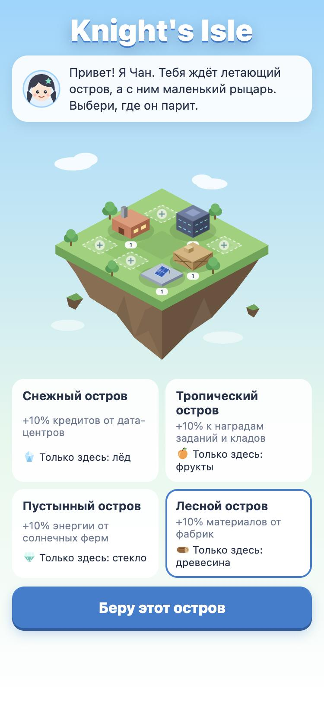
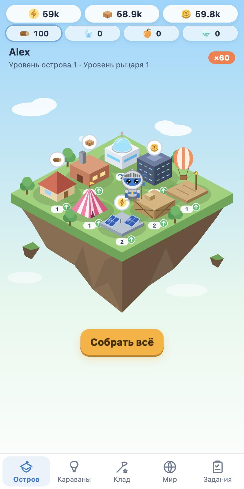

# Knight's Isle

**A cozy idle island builder that lives entirely in Telegram, with a real NEAR economy under the hood that players never have to see.**

Every player gets a small flying island and a little knight: the one embroidered on the beanie our team won at the previous NEAR hackathon. Buildings keep producing while you are away. Each biome makes its own rare resource, and from level 5 every building needs the rare resources of the other three biomes. So islands need each other: your knight carries caravans to neighbours who asked for help, pirates and storms may take part of the cargo, and good neighbours earn reputation. Islands band together into archipelagos. Every week a NEAR pool is shared by points, and the best archipelago's share goes into its own Sputnik DAO treasury.

NEAR Hackathon 2026 · tracks **09 Games With Real Economies**, **12 Social Money**, **13 Open Innovation**.

<p align="center">
  
  &nbsp;
  
</p>

## Try it

- **Play:** open the bot in Telegram and press *Open my island*. The bot link is in the submission form.
- **Rewards and proof:** `/rewards` on the same server lists the weekly pool, every closed week with its merkle root, and the last on-chain operations of the game with explorer links. Players sign in with Telegram there and claim to their own wallet.
- **Everything recorded on testnet so far:** [docs/ONCHAIN.md](docs/ONCHAIN.md).

## Why it fits the tracks

| Track | What the track asks | What Knight's Isle has |
|---|---|---|
| **09 Games With Real Economies** | NPCs with wallets, player-owned markets, an economy that changes without a patch; judged on the game loop; bonus if players never notice the chain | Resources are NEP-245 tokens in one contract. Every caravan is a real token transfer from the player to their **knight's own account** and on to the neighbour. The **wandering trader** is an NPC with its own account: its price follows its stock, and cargo lost to pirates ends up on its shelf. Four **resident islands** are NPCs with accounts and knights of their own. Players never see a wallet or a fee. |
| **12 Social Money** | Shared budgets, programmable rewards, collective ownership, reputation-based access, built on Sputnik DAO | Archipelagos are clans of islands. When one wins a week, it gets a **Sputnik DAO v2** treasury with its members as council, and its prize share is paid into it on chain. The request board works as a bounty board: help that answers a request earns reputation, and every delivery is a traceable transfer. |
| **13 Open Innovation** | An idea that doesn't fit a category | A game where the chain is fully hidden inside Telegram (Telegram allows only TON in Mini Apps), while accounts, resources, treasuries and payouts really live on NEAR, and the rewards are claimed on a separate site. |

## What is real on chain and what is not

All on **NEAR testnet**: game account `knights-isle.testnet`, resources `res.knights-isle.testnet`, reward pool `pool.knights-isle.testnet`.

| Part | On chain | Off chain (game server) |
|---|---|---|
| Player and knight accounts | Real sub-accounts `<id>.knights-isle.testnet` and `knight-<id>.knights-isle.testnet`, created on the first visit. The game holds their keys (custodial): each key is derived from one server secret, the database stores none. | Telegram id ↔ account mapping. Telegram ids never go on chain. |
| Resources | NEP-245 balances. Production is minted in batches (`mint_many`), spending is burned, caravans and trades are transfers signed by the sender's own account as NEP-366 meta-transactions; the game account relays them and pays the gas. | Building levels, timers and storage limits. |
| Wandering trader | Own account; its stock moves on chain with every deal. | The pricing rule (in `packages/core/src/trader.ts`). |
| Resident islands | Own accounts and knights; their caravans are real transfers. | Their behaviour is scripted. |
| Weekly rewards | One merkle root per week in the pool contract; anyone can `deposit()`; every claim pays real NEAR and can be checked against the root. | Points and eligibility (3 active days, island level 3, at most 5% per player), computed by the server; each payout comes with its merkle proof. |
| Archipelago treasury | A Sputnik DAO v2 created when the archipelago first wins a week; its share is paid into it. Limited to **one** DAO on testnet (a DAO costs ~6 NEAR). | Membership. **Not implemented:** automatic small payouts from the treasury by reputation and council votes on the site. |
| Reputation | Every delivery behind it is a transfer on chain. | The reputation number itself. |
| Time machine | — | Speeds up the server clock for the demo ("a week in a minute"). |

Every game action is queued and sent to the chain in order by a background processor (`apps/server/src/ops.ts`), so the game never waits for a transaction (each takes 12–19 s on testnet). `scripts/check-chain.ts` compares every player's balances in the game with the contract: on 14 Nov all players matched.

## A path for judges

1. **Start.** Open the bot, press *Open my island*, pick a biome. Chan the narrator suggests the first steps, and the daily gift pops up: a 7-day calendar with a chest on day 7 (resources only, no season points, so logging in alone cannot farm the pool).
2. **Build.** Collect what the buildings made, build the Research Lab, then a House (it makes your biome's rare resource) and the Sky Harbor.
3. **Help a neighbour.** In *Caravans*, a resident asks for your rare resource: press *Send*. Half an hour of game time later your knight is back with a reward. On `/rewards`, *What the game does on chain* shows the transfers player → knight → neighbour with explorer links.
4. **Ask for help.** Post a request for a resource you don't make. A resident's knight brings it.
5. **Trade.** Buy 10 of a rare resource from the wandering trader and watch his price move.
6. **Close a week.** Found an archipelago in *World*. In *Quests*, the time machine's *Week per minute* closes the week: the merkle root appears on `/rewards` with its transaction.
7. **Claim.** On `/rewards`, sign in with Telegram and claim to your testnet wallet. Reaching the reward bar (3 active days, island level 3) takes real play; [docs/ONCHAIN.md](docs/ONCHAIN.md) records a claim made exactly this way.

## How it is built

```
Telegram ── bot (grammY) ────────────┐
        └── Mini App (React, SVG) ───┤
                                     ▼
                     Game server (Hono, TypeScript, SQLite / Turso)
                     rules in packages/core · queue of chain operations
                                     │  meta-transactions relayed by the game account
                                     ▼
          NEAR testnet: res.* (NEP-245) · pool.* (merkle claims) · Sputnik DAO v2
                                     ▲
             Rewards site (/rewards): Telegram Login → claim to your own wallet
```

| Folder | What |
|---|---|
| `packages/core` | Game rules and every number of the economy ([ECONOMY.md](ECONOMY.md)); merkle tree shared with the contract |
| `apps/server` | Game server, Telegram auth, bot, notifications, chain queue, rewards API |
| `apps/web` | The Mini App and the rewards page |
| `contracts/resources` | NEP-245 multi-token (Rust, near-sdk 5.27) |
| `contracts/rewards-pool` | Weekly pool with merkle claims (Rust) |
| `scripts` | Testnet setup and proof run, faucet top-up, balance check |

**Telegram's rule.** Telegram allows only TON in Mini Apps and their bots. So the Mini App and the bot never mention NEAR, wallets or tokens, and never link to the rewards site: players find it through the project's X post and this README. The narrator is called Chan in the game, and the collectibles of the treasure hunt (a yocto coin, a Nightshade flower, the Doomslug, the House of Stake, an old scroll that says "Attention is all you need") are in-jokes for those who know.

## Run it locally

Node.js 22:

```bash
npm ci
npm run dev:server     # http://localhost:4310, add DEV_AUTH=1 to play without Telegram
npm run dev:web        # http://localhost:4311/?dev=1:Ann:en
```

Without chain settings the server runs with `CHAIN=sim` and only records what it would send. [DEPLOY.md](DEPLOY.md) describes running it on a server with the bot and NEAR testnet.

Tests:

```bash
npx vitest run                                     # 56 tests: rules, server, chain queue, bot, rewards
(cd contracts/resources && cargo test)             # 54 tests
(cd contracts/rewards-pool && cargo test)          # 46 tests
node contracts/rewards-pool/verify-vectors.mjs     # merkle format, checked independently
```

## Team

We built a Telegram bot at the previous NEAR hackathon and won the beanie whose knight now guards these islands.

## License

Contracts (`contracts/`): MIT. Everything else: Apache-2.0.

Design notes (in Russian): [SPEC.md](SPEC.md), [BRIEF.md](BRIEF.md), [COMPETITORS.md](COMPETITORS.md), [ECONOMY.md](ECONOMY.md).
